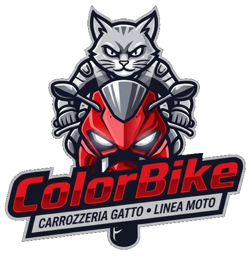

# ColorBike — Carrozzeria Gatto • Linea Moto 🏍️💨

Web Application ad alte prestazioni sviluppata per **ColorBike (Carrozzeria Gatto - Linea Moto)**, officina specializzata in verniciatura a forno, riparazione carene in ABS/compositi e realizzazione livree racing per moto stradali e da pista.



---

## 🏁 Caratteristiche Principali

- **Design System Dark-Racing**:
  - Palette cromatica: Nero Asfalto (`#09090B`), Grigio Tecnico (`#A1A1AA`) e Rosso Corsa (`#DC2626` / `#E11D48`).
  - Font tecnici: **Orbitron** (display aggressivo), **Rajdhani** (tipografia sportiva) e **Inter** (massima leggibilità).
  - Emblema circolare centrale in risalto con finiture rosse Ducati, anello telemetrico e raccordi aerodinamici.
  
- **Hero Section**:
  - Box officina racing con illuminazione d'atmosfera e superbike sportiva ad altissima risoluzione.
  - Pulsante interattivo *Configura la tua moto* con form preventivo e redirect rapido WhatsApp.

- **Sezione Servizi a 6 Slot**:
  - 3 servizi attivi con specifiche tecniche e badge di telemetria.
  - 3 slot disponibili con bordo tratteggiato *"Servizio in Arrivo"*, configurabili direttamente dal pannello di gestione.

- **Gallery "Prima & Dopo" Interattiva**:
  - Slider con laser divider centrale trascinabile (mouse e touch screen) per confrontare carene prima e dopo la lavorazione.
  - Filtri per categoria (*Verniciatura*, *Riparazione*, *Livree Racing*).

- **Pannello Gestione / No-Code CMS Integrato**:
  - Accesso protetto da PIN (Default: `0000`) tramite icona ⚙ o scorciatoia `Ctrl + Shift + A`.
  - Gestione in tempo reale dei 6 slot dei servizi.
  - Upload e pubblicazione immediata di nuovi lavori Prima/Dopo con anteprima foto.
  - **Esportazione & Importazione `data.json`**: scarica la configurazione aggiornata con un click e sostituiscila nel repository per rendere definitivi tutti i contenuti senza bisogno di un database esterno.

---

## 🚀 Come Pubblicare su GitHub Pages (Hosting Gratuito)

L'applicazione è 100% statica (HTML5, CSS3, Vanilla JS), quindi perfetta per **GitHub Pages** a costo zero e con caricamento istantaneo:

1. **Crea un nuovo repository su GitHub**:
   - Vai su [github.com/new](https://github.com/new).
   - Chiama il repository (es. `colorbike-web`).
   - Lascialo pubblico (o privato se hai GitHub Pro) e **non** aggiungere README o .gitignore (sono già pronti qui).

2. **Collega e invia il codice dal tuo computer**:
   Apri il terminale nella cartella del progetto (`e:\ColorBike sito Web`) ed esegui:
   ```bash
   git remote add origin https://github.com/TUO_USERNAME/TUO_REPOSITORY.git
   git branch -M main
   git push -u origin main
   ```

3. **Attiva GitHub Pages**:
   - Nel tuo repository su GitHub, vai su **Settings** > **Pages** (nel menu laterale sinistro).
   - Sotto **Build and deployment** > **Source**, seleziona:
     - Branch: `main`
     - Folder: `/ (root)`
   - Clicca su **Save**.
   - Entro 1-2 minuti il tuo sito sarà online all'indirizzo:
     `https://TUO_USERNAME.github.io/TUO_REPOSITORY/`

---

## 🛠️ Struttura dei File

```text
ColorBike sito Web/
├── index.html              # Struttura semantica completa e accessibile
├── style.css               # Design system dark-racing modulare
├── app.js                  # Logica slider, filtri, preventivo e pannello CMS
├── data.json               # Database locale dei servizi e dei lavori
├── logo1.jpeg              # Logo originale
├── logo_transparent.png    # Logo scontornato trasparente ad alta risoluzione
├── .gitignore              # Esclusioni file temporanei/sistema
└── README.md               # Documentazione del progetto
```

---

## 📞 Contatti Officina
- **Brand**: ColorBike — Carrozzeria Gatto • Linea Moto
- **Sede**: Via della Pista 42, Torino (TO)
- **Email**: info@colorbike.it
- **Assistenza / Foto Danni**: [WhatsApp Diretto](https://wa.me/393401234567)
